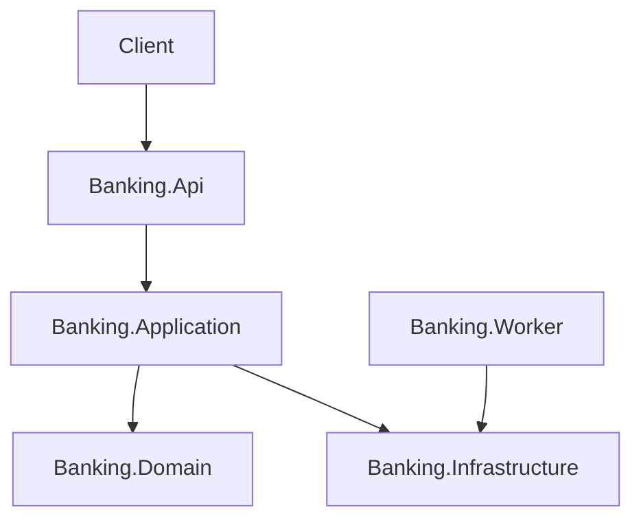

# Banking API

Banking API built with .NET 8 to demonstrate senior backend engineering practices: Clean Architecture, DDD, CQRS, Event Sourcing, Transactional Outbox, idempotent financial operations, concurrency control, observability, integration testing with Testcontainers, and CI/CD automation.

## Overview

This repository is being implemented incrementally. The first milestone creates the solution structure, a pure domain model, and unit tests for financial invariants.

## Current Milestone

- Clean Architecture solution structure.
- Pure `Banking.Domain` project.
- Account aggregate, money value object, identifiers, domain events, and domain exceptions.
- Unit tests for account lifecycle, money movement, and transfer behavior.

## Architecture



## How to Build

```bash
dotnet restore
dotnet build
dotnet test tests/Banking.UnitTests/Banking.UnitTests.csproj
```

## Roadmap

Future milestones will add PostgreSQL Event Store, CQRS handlers, REST endpoints, JWT and refresh tokens, idempotency, read models, Redis, RabbitMQ, Transactional Outbox, observability, integration tests, architecture tests, CI/CD, and performance scripts.

