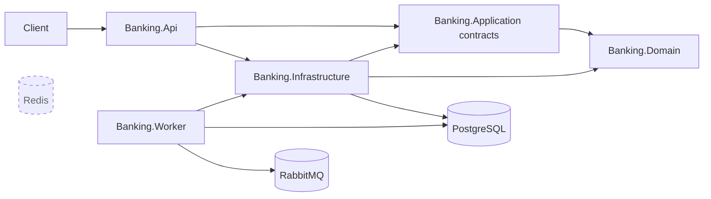
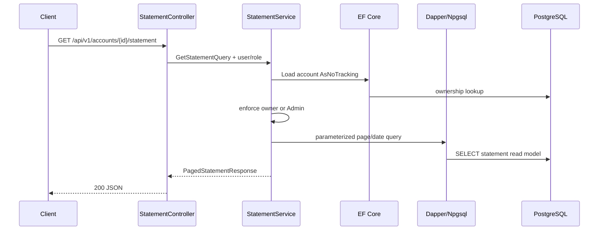

# LedgerFlow architecture

## Scope and evidence

This is a source-verified snapshot of commit `328c9c0` on 2026-10-01. It distinguishes implemented behavior from intended evolution. The legacy `README.md`, `plano.md`, existing ADRs, tests, migrations, and source were inspected; source wins where they conflict.

## Current architecture

### Solution structure

| Project | Responsibility | Direct project dependencies |
| --- | --- | --- |
| `Banking.Domain` | Account aggregate, money/ID value objects, domain events and exceptions | None |
| `Banking.Application` | Use-case contracts, command/query records, response DTOs, persistence/clock/outbox ports, application exceptions | `Banking.Domain` |
| `Banking.Infrastructure` | EF Core/PostgreSQL persistence, event store, synchronous projections, Dapper statement query, auth, idempotency, outbox writer, service implementations | `Banking.Application`, `Banking.Domain` |
| `Banking.Api` | ASP.NET Core controllers, validation, JWT authentication, authorization policies, rate limiting, Swagger, middleware, health endpoints, logs/traces | `Banking.Application`, `Banking.Infrastructure` |
| `Banking.Worker` | Polls PostgreSQL outbox and publishes through MassTransit to RabbitMQ | Application, Infrastructure, Domain |
| `Banking.UnitTests` | Pure domain behavior | Domain |
| `Banking.IntegrationTests` | In-process API with PostgreSQL/Redis/RabbitMQ Testcontainers | API, Infrastructure, Application |
| `Banking.ArchitectureTests` | Selected reference and controller-boundary rules | Domain, Application, Infrastructure, API |

All projects target `net8.0`; no `global.json` pins an SDK. NuGet versions are declared independently in each project (no central package management).



Redis is drawn disconnected intentionally: Compose and integration fixtures start it, but no production project references a Redis client or reads its connection string.

### Architectural style and patterns

- Layered/Clean Architecture dependency direction is partly enforced by NetArchTest.
- The solution is a modular monolith in code organization with two deployable processes (API and worker), not microservices.
- Domain modeling is concentrated in the `Account` aggregate. It applies and emits events for opening, status, deposit, debit, credit, and transfer.
- Event sourcing is used for account streams only. Users, refresh tokens, idempotency records, PIX keys, transfer views, statement views, and outbox records are conventional relational state.
- CQRS is lightweight: command/query records and separate read models/services. There is no mediator, handler pipeline, or independently deployed read store. Most queries use EF Core; only statement entry retrieval uses Dapper.
- Read models are updated synchronously in the same application service, usually inside the financial transaction. There is no projection consumer/rebuild process.
- Dependency injection binds application interfaces directly to Infrastructure service classes.

### Persistence and schema

`BankingDbContext` manages nine table sets:

- `event_store`
- `users`
- `refresh_tokens`
- `accounts_read_model`
- `idempotency_records`
- `transfers_read_model`
- `statement_entries_read_model`
- `pix_keys`
- `outbox_messages`

EF Core 8 with Npgsql owns mappings and migrations. The API calls `MigrateAsync()` during startup and seeds two development users only in `Development`. Database migrations are therefore coupled to API availability and simultaneous replicas have not been addressed.

Account events store assembly-qualified CLR type names, JSON payload/metadata, aggregate version, correlation/causation/user IDs, and occurrence time. Rehydration resolves CLR types with `Type.GetType`, so assembly/type renames need an explicit event-compatibility strategy.

`(aggregate_id, aggregate_version)` is unique. `PostgresEventStore.AppendAsync` first reads the current maximum version and translates that unique-constraint violation into `ConcurrencyConflictException`.

### Transactions, concurrency, and idempotency

- Deposit and transfer explicitly begin an EF transaction. Event append calls `SaveChangesAsync`, then projections/idempotency/outbox are saved, and the transaction commits. PostgreSQL is the atomic boundary for those operations.
- Transfer obtains `SELECT ... FOR UPDATE` on the source account read-model row before rehydrating streams. Destination is not row-locked. The event-store unique key remains a second concurrency guard.
- Account open and account activation/deactivation append the event and update the read model through separate saves without an explicit encompassing transaction. A failure between saves can leave stream and projection inconsistent.
- Idempotency records have a unique `(user_id, operation_type, idempotency_key)` index and store a request hash and serialized success response for 24 hours. No cleanup job exists. The pre-check followed by insert is race-prone; a simultaneous duplicate can surface as an unhandled database uniqueness error rather than a replayed response.
- PIX payment invokes the transfer service (which commits) and then persists a separate PIX-completed outbox record. The transfer is durable if the second save fails, so that PIX integration event is not transactional with the payment result.

### Representative request traces

#### Read: account statement



Page is clamped to at least 1 and page size to 1–100. Pagination is offset-based and the response has no total count. The index is `(account_id, occurred_on)`; no query-plan evidence is committed.

#### Non-financial write: open account

`POST /api/v1/accounts` is authenticated. The controller extracts `sub` and `role`, then calls `AccountService.OpenAsync`. Only a `Customer` role is accepted. `Account.Open` raises `AccountOpened`; the event store saves stream version 1, then an account read-model row is saved separately. A `201` response returns the read model. There is no explicit transaction covering both saves and no idempotency key for account creation.

#### Financial write: transfer

```mermaid
sequenceDiagram
    participant C as Client
    participant A as TransfersController
    participant S as TransferService
    participant DB as PostgreSQL transaction
    participant D as Account aggregate
    C->>A: POST /api/v1/transfers + JWT + Idempotency-Key
    A->>S: TransferMoneyCommand
    S->>DB: check idempotency record
    S->>DB: BEGIN; lock source read row
    S->>DB: load source/destination streams
    S->>D: rehydrate; TransferTo
    D->>D: validate active, distinct, sufficient funds
    S->>DB: append both streams with expected versions
    S->>DB: update accounts + statements + transfer view
    S->>DB: insert idempotency + outbox
    S->>DB: COMMIT
    S-->>A: TransferResponse
    A-->>C: 201 JSON
```

The source stream receives debit plus `TransferCompleted`; the destination receives credit. A conflict, invariant failure, or save failure rolls back the explicit transaction. The controller maps known conflicts to HTTP 409.

### Authentication and authorization

- Symmetric HMAC-SHA256 JWT access tokens contain `sub`, `email`, `jti`, and `role` and default to 15 minutes.
- Passwords use PBKDF2-SHA256 with a random 16-byte salt, 100,000 iterations, and fixed-time verification.
- Refresh tokens are 64 random bytes, stored only as SHA-256 hashes, default to seven days, and rotate on refresh.
- Controllers use `[Authorize]`; account activation/deactivation additionally use `AdminOnly`. Service-level ownership and role checks provide resource authorization.
- Development configuration contains intentionally local database credentials and JWT key. There is no production secret-provider configuration, OIDC provider, MFA, lockout, email verification, or token-family reuse detection.
- The development seeder stores `NormalizedEmail` uppercase while registration/login normalize lowercase. Because PostgreSQL comparison is case-sensitive, documented seeded login credentials likely fail.

### Validation and error handling

FluentValidation auto-validates auth and financial request bodies at the API boundary. Services repeat some invariant/argument checks. Controllers manually catch known exceptions and return `ProblemDetails`; there is no central exception handler. Unlisted exceptions can become generic 500 responses, and mapping is inconsistent (for example, deposit does not catch `ConcurrencyConflictException`).

### Messaging and outbox

Financial services add serialized integration events to the PostgreSQL outbox. The worker polls up to 20 pending rows every five seconds, marks each `Processing`, publishes with MassTransit, then marks it `Processed`; failures are retried up to five times and marked `Failed`.

Current limitations:

- No RabbitMQ consumers or product behavior driven by messages.
- No test runs the worker through publish/ack behavior; tests only assert pending outbox rows.
- Poll/claim is not atomic across worker replicas and does not use `SKIP LOCKED`/leases. Multiple workers may select the same pending rows.
- A worker crash after setting `Processing` can strand a message permanently; only `Pending` is polled.
- Broker publish followed by database status update is at-least-once in principle, so consumers must be idempotent when introduced.
- Worker logging/tracing/health and dead-letter operational workflows are minimal or absent.

### Caching

There is no caching implementation. Redis in Compose, README, ADR 0006, and the Testcontainers fixture is an unused placeholder. PostgreSQL stores idempotency records and ASP.NET's in-memory fixed-window limiter implements rate limiting.

### Observability and operations

- Serilog writes structured console logs; request logging and a correlation-ID log property are enabled.
- `X-Correlation-ID` is accepted/generated and returned, but application-created event/outbox correlation IDs are new GUIDs rather than the HTTP correlation value.
- OpenTelemetry instruments ASP.NET Core and outgoing `HttpClient` traces and exports to console. Metrics and a production exporter are not configured.
- `/health/live` and `/health/ready` run the same empty health-check registration. Neither checks PostgreSQL, RabbitMQ, Redis, migrations, or worker state.
- A global per-user/IP fixed-window rate limit allows 1,000 requests/minute per API instance. It is not distributed.
- Dockerfiles build API and worker; Compose runs both plus PostgreSQL, Redis, and RabbitMQ. Images run as the container default user and have no service health checks for API/worker.

### Testing and delivery

- 20 domain unit tests, 22 API integration tests, and 4 architecture tests are present; 46 `[Fact]` tests total.
- Integration tests start PostgreSQL, Redis, and RabbitMQ containers, but the in-process API uses only PostgreSQL. They test auth, accounts, deposit/transfer/PIX, statements, idempotency records, outbox writes, health, and source-account concurrent transfers.
- No unit tests cover infrastructure services. There are no worker publish tests, migration tests, contract tests, resilience tests, or end-to-end API+worker+broker-consumer tests.
- GitHub Actions restores, builds Release, verifies format, runs all three test projects, and builds Compose images. It does not publish artifacts, scan dependencies/images, deploy, or exercise k6.
- k6 starter scripts and recorded results exist; targets are aspirations, not enforced service-level objectives.

## Documentation discrepancies found

| Existing claim | Verified state |
| --- | --- |
| Redis appears in the architecture/tech stack and is described for cache, idempotency lookup, rate limiting, and locks | No Redis client or runtime use exists; starting it is unnecessary for the API today |
| “OpenTelemetry traces and metrics” | Tracing only; console exporter only |
| Live and ready health checks suggest operational readiness | Both endpoints are equivalent and have no registered dependency checks |
| Integration tests use PostgreSQL, Redis, and RabbitMQ behavior | Containers start, but current API tests exercise PostgreSQL only; worker/broker/Redis behavior is not tested |
| Development seed credentials are usable | Seeder/query normalization differs by case; source indicates login failure |
| Transactional outbox broadly covers financial operations | Deposit and transfer records are atomic; the PIX-specific event is saved after the transfer commits |
| “CQRS with Dapper read models” can imply all query paths use Dapper | Most reads use EF Core; Dapper is limited to statement entries |

## Possible future evolution (not a design decision)

Evolve only in response to roadmap problems. Likely directions include closing existing atomicity/idempotency/worker gaps; richer domain and ledger semantics; dependency-aware health and telemetry export; measured query/index optimization; asynchronous consumers when a real side effect needs decoupling; and later streaming or distributed deployment only if scale, independent ownership, replay, or availability requirements justify them.

